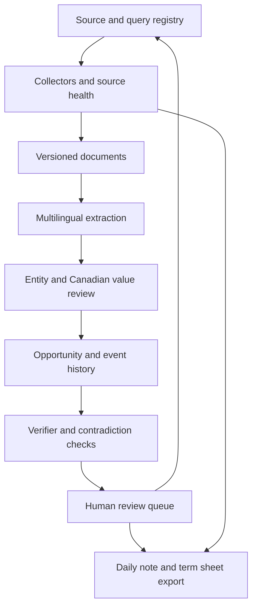

# China related economic opportunity monitor

Research baseline: 27 October 2026. This package contains public sources and analyst proposals. It does not contain approved government asks.

## Start here

1. Read the opportunity scan and the two page term sheet in the reports folder.
2. Open data/opportunities.csv or data/opportunities.json. There are 28 records and 55 source references.
3. Run the offline demo and tests using Python 3.11 or later. No external package is required for the reference pipeline.

```bash
python pipeline.py --demo --out demo-output
python -m unittest discover -s tests -v
```

The demo replays historical and synthetic test events. Its digest and database are examples, not evidence that any source was scanned today. Live web collection, search API calls, model extraction, automatic entity resolution, review UI, scheduling and delivery are not implemented.

## Architecture



These are functional roles. Start with one orchestrator and deterministic steps; do not assume eight autonomous agents are necessary.

## Purpose and outputs

The system should answer three operational questions each day: What commercially meaningful lead is new? What has changed in an existing lead? What decision, deadline or obstacle now merits human attention? It should generate a short daily change note, an inspectable opportunity register and a source coverage report. The two page term sheet is an approved export from the register.

Keep opportunity discovery separate from PM ask drafting. A policy statement, a new research paper, a market growth projection or a company appearance at a trade show can trigger research, but cannot alone become a transaction or a government ask.

## A manageable first implementation

Use Python, SQLite, a private code repository and a simple review interface or CSV export. Keep the LLM and web search provider behind small adapters so the students can compare services. Use an institution approved scheduler and model endpoint; do not require a complex multi agent framework to establish the baseline.

The provided executable reference is deliberately offline: it loads the researched seed register, validates records, records fixture events, detects duplicates and out of order evidence, and emits a daily digest. It has no live crawler, model credentials, email sending or recurring schedule. The adapter contract, prompts and tests define the next development tasks.

## Collection and source coverage

Maintain a registry at the page, feed or query level with owner, language, stack, authority, canonical URL, method, cadence and last successful collection. The starter contains 55 reference sources. Search results used in this research do not establish that each source can be fetched reliably by a production crawler.

Begin by testing collection for the highest priority official and company sources. Broaden through recurring Chinese and English entity queries, French Canadian releases, provincial and municipal investment offices, sector associations, buyer tenders and filings. Use RSS, sitemaps and documented APIs where available; use a search provider for discovery and fetch the underlying document for evidence.

For scale, test a target of several hundred priority pages daily and several thousand broader discovery pages weekly. These are design targets, not achieved coverage. Record sources attempted, successful fetches, changed documents, unreadable PDFs, failed OCR and blocked pages. A failed source must never produce a finding of no change.

## Agent responsibilities

A research planner proposes bounded queries for each stack, company and open validation gap. It may add a candidate source to a review queue but cannot change the approved source policy itself. Domain expansion should be visible and limited by a daily search and token budget.

A multilingual extractor converts a document into evidence supported claims, named entities, dates, monetary values, units, contract stage and territories. It preserves Chinese names, a short original language support span and an English rendering, with page, paragraph or heading locators. Unknown fields remain null.

An entity resolver links English and Chinese aliases, legal entities, subsidiaries, tickers and project names. A Canadian value analyst identifies the Canadian operating site, origin, ownership, intellectual property, employment and cash flow path. Neither company branding nor Canada commercial rights are sufficient evidence of Canadian economic value.

A change analyst compares claims with the existing event history and drafts only material deltas. An independent verifier checks whether each factual claim follows from its source, searches for superseding or contradictory material, and flags false Canadian attribution. A human editor accepts, changes, rejects or parks the record.

## Opportunity state and event history

Use separate records for sources, documents, claims, entities, opportunities, events and reviews. A source can generate many claims; one opportunity can have many events and several stack tags. Give the commercial opportunity one stable identity so that the same isotope or energy project is not counted twice across stacks.

Track discovery, negotiation, memorandum or heads of agreement, definitive contract, regulatory condition, final investment decision, financing, construction, operation, realized receipts, paused, cancelled and closed. Market access has its own stages: announced, legally effective, operationally usable, expiring and suspended. A new publication date does not establish a new event.

Store publication date, underlying event date, effective date, expiry date, first seen, last checked and review date separately. Retain prior values and source lineage. An old article discovered today must not overwrite a newer decision. Conflicting authoritative evidence should create a conflict flag, not be silently resolved by whichever document arrived last.

## Minimum evidence and readiness rules

For a commercial record, require a named buyer, investor or sponsor; an identifiable product, asset or work package; a Canadian economic pathway; and a source that supports the claimed stage. A broad market thesis remains discoverable in a separate queue when these are missing.

For a Top Ask, require in addition a precise decision or action, a counterpart with authority, a live and verified obstacle or transaction step, an agreed requested timing, a responsible Canadian owner, a quantified value or an explicit defensible reason it is unavailable, and recorded departmental and company validation. The reference pipeline never promotes a record to Top Ask automatically.

A single authoritative legal notice can establish a rule. A company filing can establish that company announcement. Ten syndicated copies are still one underlying source. Commercial willingness from the other party, capacity available for sale, actual investment disbursement and regulatory permission need their own evidence.

## Ranking and alert rules

Keep materiality, commercial maturity, Canadian value, government relevance and urgency as separate fields. A heuristic review priority may combine them, but evidence confidence remains separate and no score should be described as a calibrated probability. Unknown value is a validation task, not zero value.

Alert on a new named opportunity; contract or financing stage change; changed amount, capacity or timing; a relevant licence or establishment decision; a tariff or quota change; an approaching expiry; withdrawal, cancellation or loss of Canadian value. Suppress duplicate coverage, generic sector commentary and rewritten announcements with no new commercial fact.

Use configurable 60, 30, 14 and 7 day expiry reminders with an alert key so the same threshold is not emailed repeatedly. Keep source outages in the coverage section. Every daily item should show previous status, new evidence, why it matters for Canada, the next validation task and links.

## Amounts and Canadian attribution

Store original amount and currency, amount type, basis date, quantity and unit, and any independently sourced exchange rate. Separate paid upfront cash, contingent milestones, annual sales, project capital expenditure, financing, equity purchase price and global market size. Do not convert an undisclosed amount into an estimate simply to complete the term sheet.

Maintain a parent transaction identity, territorial scope and Canadian attributed share if verified. Avoid adding seed, meal and oil from the same feedstock; committed LNG capacity and its project cost; a platform acquisition and processed payment volume; and maximum biotech milestones and current receipts. Without verified attribution, report the original disclosed number as context and Canadian benefit as unquantified.

## Operational reliability and source safety

Cache content and hashes, retain immutable evidence versions and retrieval metadata, honour source conditions, rate limit by domain, use timeouts and bounded retries, and keep PDFs and OCR in a separate parsing worker. Protect against prompt injection by treating every retrieved document as untrusted data; retrieved text cannot issue tool instructions or change the source policy.

For fetchers, validate redirects and block private network destinations; limit MIME types, file sizes and decompression; do not execute downloaded content. Keep secrets outside prompts and repositories. Flag source corrections and data removal issues for the project owner.

Separate a public student environment from GAC internal validation and export. Do not load internal term sheets, negotiating positions, mission reporting or firm confidential documents into student systems. The public system can export structured evidence for an approved internal workflow. No automated contact with companies, missions or counterpart officials is necessary.

## Human workflow and term sheet export

Assign an OPR product owner, a designated departmental reviewer for each stack and a technical lead. Beijing and Shanghai commercial teams can validate counterparts and file status; Canadian regional teams can validate domestic activity. These are suggested responsibilities, not assignments to colleagues.

Use a review form with current fact, change, evidence quality, Canadian value, commercial owner, government action, action owner and date. The reviewer can accept, request corroboration, mark outdated, merge duplicates, or move a record to a hypothesis queue.

Export the three columns exactly as STRATEGIC STACK, COUNTRY CONTEXT & STRENGTHS, and AREAS OF CURRENT & FUTURE COOPERATION. In the third column, retain TOP ASKS and OTHER OPPORTUNITIES. Include only approved asks; if none qualifies, say so. Keep working questions and source detail in the linked annex.

## Evaluation before live use

Create a bilingual benchmark of roughly 80 documents balanced across the four stacks, including older and newer versions of the same file. Two human reviewers label entities, facts, stage, Canadian nexus, material changes and whether an ask is justified; reconcile disagreements before scoring.

Proposed acceptance targets: at least 85% precision for qualified opportunities; at least 80% recall for material changes in the labelled set; source and locator on every released factual claim; no fabricated amounts or dates; no automatic Top Ask approvals; and fewer than 5 duplicate alerts per 100 alerts. These are proposed gates, not measured system performance.

Measure coverage separately from accuracy, and report results by stack and language. Time a reviewer on the daily digest and aim for a manageable 10 to 15 minute triage, then revise the scope if that target is missed. Track cost per reviewed useful lead and material event, not just pages collected.

## A six week student sequence

Week 1: agree opportunity definitions, Canadian value tests and public data boundaries; validate the seed records and build the labelled benchmark. Deliver a source accessibility report.

Week 2: implement collection, canonical URLs, document hashes, provenance and a basic registry. Produce a replayable daily run with source failures visible.

Week 3: implement multilingual extraction and entity resolution. Compare extraction with a simple keyword baseline and audit amounts, dates and territories.

Week 4: implement event history, change detection, expiry alerts and contradiction review. Run the stale evidence and duplicate tests supplied in the package.

Week 5: add a review interface and term sheet export. Have domain reviewers evaluate a small sample and measure triage time.

Week 6: conduct a shadow daily run against the benchmark, fix the largest errors and hand over source documentation, evaluation results, costs and unresolved gaps. Expand only after the initial sources and definitions work.

## Package map

- `pipeline.py`: offline validation, event history, duplicate handling, conflicts, coverage and digest.
- `adapters.py`: interfaces for live collectors, search, extraction and verification.
- `schemas/register.sql`: reference database and extension tables.
- `schemas/extraction.schema.json`: draft JSON Schema for model extraction.
- `data/opportunities.json` and `.csv`: researched seed register.
- `data/sources.json` and `source_catalog.csv`: source catalogue with retrieval limitations.
- `data/query_examples.json`: bilingual and French discovery examples.
- `data/entity_aliases.json`: a small manually curated alias starter.
- `data/demo_events.jsonl`: explicitly labelled replay examples.
- `data/evaluation_cases.jsonl`: reviewer tasks and expected handling.
- `prompts/`: bounded extraction, analysis, verification and drafting instructions.
- `tests/`: deterministic regression tests; these do not validate an LLM or live source coverage.
- `reports/`: final research and term sheet in Word and PDF.

## Current limits

The duplicate key assumes manually resolved opportunity IDs, dimensions and values. It is not a semantic entity resolver. Same date conflicts are flagged; disagreements between differently dated authoritative claims also need a fuller claim and authority model. The sample does not compute realized Canadian value, infer undisclosed deal amounts, implement a calibrated ranking model, or persist expiry alert thresholds. The live implementation should add those only with validated definitions and tests.

The public seed register is richer than the replay state. Seed records are stored unchanged; demo events populate a separate current_state table. A live implementation should build initial state from reviewed claims and keep both representations reconciled.

No automatic outgoing communication is included. Work with the course supervisor and OPR product owner to choose the approved environment and review process.

## Additional working files

`data/discovery_channels.json` adds 15 publisher or search channels for collection design. Proposed cadences are untested. `data/review_template.csv` is a blank validation worksheet; handle non public completions in the appropriate internal environment. `examples/` contains an offline digest and event outcomes. `VALIDATION.md` records checks and limits.
